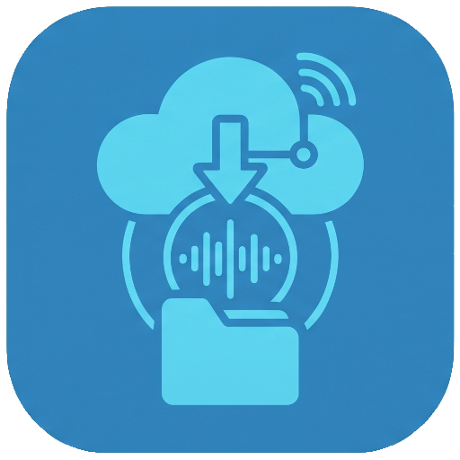

<p align="center">
  
</p>

# Call Recording Downloader for Ringover

[](https://github.com/leoleiria/call-recording-downloader/actions/workflows/ci.yml)
[](LICENSE)


**Download every call recording, voicemail and transcription you had with a contact, in one click.**

A free desktop app for Windows, macOS and Linux. Type a phone number, paste your Ringover API key,
pick a period, and the app finds every call with that contact and saves the audio and transcriptions
in a tidy folder on your computer.

> This project is not affiliated with, endorsed by or sponsored by Ringover.
> Ringover is a trademark of its owner. The app only uses Ringover's public API.

[Download](https://github.com/leoleiria/call-recording-downloader/releases) ·
[User guide](docs/user_guide.md) ·
[Build from source](_docs/dev_setup.md)

## Features

| | |
|---|---|
| **One contact, up to a year** | Search any period up to one year; it is split automatically into 14-day requests to respect the API limit. |
| **Know before you download** | Shows how many calls, recordings (including voicemails) and transcriptions exist. |
| **Choose what to save** | Recordings and transcriptions, only recordings, or only transcriptions. |
| **Readable transcriptions** | A `.txt` with timestamps and speakers, plus the original JSON kept untouched. |
| **Safe to run again** | Files that already exist are skipped, and interrupted downloads never leave broken files. |
| **Your key stays yours** | The API key is never stored, is masked on screen and is always masked in the logs. |
| **24 languages** | Every official language of the European Union. |

## What you get

```
<folder you choose>/
└── 34666666666/                                   ← the contact number
    ├── 2025-01-15_14-32-05_in_<callId>.mp3        ← recording
    ├── 2025-01-16_09-10-44_in_<callId>_voicemail.mp3
    ├── 2025-01-15_14-32-05_in_<callId>_transcription.txt
    └── OriginalTranscription_Json/
        ├── 2025-01-15_14-32-05_in_<callId>_transcription.json  ← as returned by Ringover
        └── manifest.csv                           ← index of every call and file
```

File names start with the local date and time of the call (so they sort chronologically), then the
direction (`in`/`out`) and the call id.

## Requirements

- A Ringover account with an API key that has the **Calls → Read** permission.
  Transcriptions also require the transcription feature in your Ringover plan.
- Nothing else: release downloads include their own Java runtime.

## Downloads

Get the latest version from [GitHub Releases](https://github.com/leoleiria/call-recording-downloader/releases):

- **Windows**: `.msi` installer (no administrator rights needed; adds Start menu and optional
  desktop shortcuts), or a portable `.zip` if you prefer not to install anything.
- **macOS**: `.dmg`.
- **Linux**: `.deb`.

The packages are not code-signed yet, so Windows SmartScreen and macOS Gatekeeper may ask for
confirmation the first time. See the [user guide](docs/user_guide.md#first-launch).

## Documentation

- [User guide](docs/user_guide.md): creating an API key, using the app, troubleshooting
- [Development setup](_docs/dev_setup.md): building, running and packaging from source
- [Architecture](_docs/architecture.md): modules, layers and design decisions
- [Ringover API notes](_docs/ringover_api_notes.md): how the app uses the API
- [Contributing](CONTRIBUTING.md) · [Security policy](SECURITY.md) · [Roadmap](ROADMAP.md) · [Changelog](CHANGELOG.md)

## Support and requests

All questions, bug reports and feature requests go through
[GitHub Issues](https://github.com/leoleiria/call-recording-downloader/issues/new/choose), using the
templates. Security problems go through a
[private security advisory](https://github.com/leoleiria/call-recording-downloader/security/advisories/new).
Requests sent through any other channel are not handled.

## License

Released under the [MIT License](LICENSE). The software is provided "as is", without warranty of any
kind; the authors are not liable for any claim, damages or other liability arising from its use.
Third-party components and their licenses are listed in [NOTICE](NOTICE).
